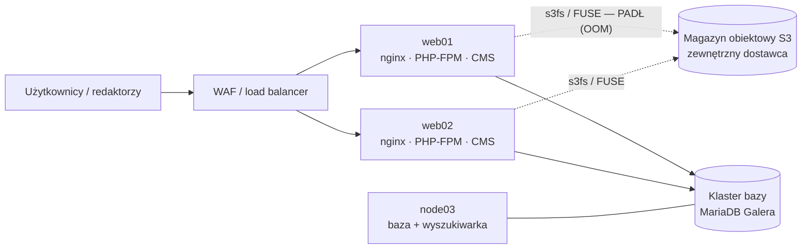

# Day 002 – Portal nie zapisuje plików: padł montaż magazynu S3 (OOM)

<div class="ad-pills">
<span class="ad-pill hot">incydent produkcyjny</span>
<span class="ad-pill">przypadek rzeczywisty · zanonimizowany</span>
<span class="ad-pill ok">przyczyna ustalona</span>
<span class="ad-pill ok">usługa przywrócona</span>
<span class="ad-pill warn">poprawki zaplanowane</span>
</div>

<div class="ad-kpis">
<div class="ad-kpi hot"><small>przestój zapisu plików</small><b>~8 h</b><span>od 03:47 do przywrócenia montażu</span></div>
<div class="ad-kpi hot"><small>pamięć procesu montażu</small><b>~3 GB</b><span>RSS w chwili zabicia przez OOM</span></div>
<div class="ad-kpi warn"><small>auto-restart usługi</small><b>brak</b><span><code>Type=oneshot</code>, bez <code>[Unit]</code></span></div>
<div class="ad-kpi ok"><small>zmiany na produkcji</small><b>1</b><span>ponowny montaż, uzgodniony</span></div>
</div>

!!! info "Anonimizacja"
    Nazwy organizacji, jednostek, dostawców, produktów, domen, adresy IP, nazwy hostów
    i magazynów oraz dane logowania zostały usunięte lub zastąpione. Polecenia i wyniki
    są prawdziwe, zmienione są tylko identyfikatory. Szczegóły:
    [Zasady anonimizacji](../about/anonymization.md).

## 1. Scenariusz

Zgłoszenie od redaktora jednej z jednostek: *„serwer nie ma zapisu do strony, nie da się
wgrać plików do mediów”*. Portal to publiczny serwis repozytorium cyfrowego oparty o CMS,
w którym wiele jednostek dodaje własne materiały.

Zadanie: ustalić, dlaczego zapis plików przestał działać, i przywrócić usługę,
nie zmieniając niczego ponad to, co konieczne.

## 2. Środowisko

<figure class="ad-chart">



<figcaption>Katalog mediów CMS (<code>…/uploads</code>) to dowiązanie do magazynu obiektowego S3,
montowanego na każdym froncie przez s3fs (FUSE). Gdy montaż na web01 pada, front nadal serwuje
stronę (baza działa), ale nie może zapisać ani odczytać plików.</figcaption>
</figure>

- **Aplikacja:** publiczny CMS (PHP), serwis wielojęzyczny, wiele jednostek na wspólnej instalacji.
- **Fronty:** web01, web02 — Debian 12, nginx, PHP-FPM 8.2, przyjmują ruch z WAF/load balancera.
- **Baza i wyszukiwarka:** MariaDB (Galera) na web01, web02 i węźle pomocniczym node03,
  plus silnik wyszukiwania pełnotekstowego.
- **Pliki mediów:** zewnętrzny **magazyn obiektowy S3**, zamontowany na frontach przez **s3fs (FUSE)**
  jako usługa systemd. `…/wp-content/uploads` jest dowiązaniem symbolicznym do ścieżki na tym montażu.
- **Moje uprawnienia:** SSH na konto z `sudo` (z hasłem). Polecenia root wykonywał właściciel konta
  w swoim terminalu, ja analizowałem wynik. Diagnostyka wyłącznie na odczycie, poza jednym
  uzgodnionym ponownym montażem.

## 3. Problem

Próba wejścia do katalogu mediów kończyła się błędem systemu plików:

```text
ls: cannot access 'uploads/*': Transport endpoint is not connected
uploads -> /…/uploads_dysk/           # dowiązanie do ścieżki na montażu S3
```

`Transport endpoint is not connected` to typowy objaw **martwego montażu FUSE**:
systemd nadal uważa punkt montowania za aktywny, ale proces, który go obsługiwał, już nie żyje.
Właściciel plików i uprawnienia były poprawne — to nie był problem z prawami dostępu.

## 4. Diagnostyka

Szedłem od symptomu do procesu obsługującego montaż: punkt montowania → typ montażu →
stan usługi → logi jądra.

### Przebieg w skrócie

<ul class="ad-timeline">
<li><b>Objaw to nie uprawnienia</b><span>Właściciel i prawa katalogu poprawne; błąd dotyczy transportu, nie dostępu.</span></li>
<li><b>Dowiązanie prowadzi na montaż</b><span><code>uploads</code> wskazuje ścieżkę na zamontowanym magazynie S3.</span></li>
<li><b>Montaż to s3fs (FUSE)</b><span>systemd pokazuje montaż jako aktywny, ale dostęp zwraca błąd transportu.</span></li>
<li class="hot"><b>Proces montażu zabity przez OOM</b><span>Log jądra: o 03:47 OOM-killer kończy proces s3fs (~3 GB RSS).</span></li>
<li class="hot"><b>Usługa się nie podnosi</b><span><code>Type=oneshot</code>, brak sekcji <code>[Unit]</code> i auto-restartu.</span></li>
<li><b>Drugi front: montaż żyje, ale ma nieaktualny cache</b><span>Chwilowo nie widzi części katalogów (<code>enable_noobj_cache</code>).</span></li>
<li class="ok"><b>Ponowny montaż przywraca zapis</b><span>Odmontowanie martwego punktu i restart usługi.</span></li>
</ul>

### 4.1 Czy to na pewno montaż, a nie uprawnienia?

```bash
ls -ld . uploads
id
ps -eo user,comm | grep -Ei 'php|nginx' | sort | uniq -c
```

**Wynik:** katalog i dowiązanie mają poprawnego właściciela; PHP-FPM i nginx działają jako
użytkownik serwera WWW. Błąd `Transport endpoint is not connected` nie ma związku z prawami —
wskazuje na warstwę montażu.

### 4.2 Co jest zamontowane pod ścieżką mediów?

```bash
mount | grep -E '/…/data'
systemctl status <usługa-montażu>.mount --no-pager | head -15
```

**Wynik:** pod ścieżką mediów jest **s3fs typu `fuse.s3fs`**, montowany jako usługa systemd.
systemd raportuje montaż jako `active (mounted)` od wielu miesięcy — ale sam dostęp do ścieżki
zwraca błąd transportu. To znaczy, że proces obsługujący montaż już nie żyje, a systemd o tym nie wie.

### 4.3 Dlaczego proces montażu nie żyje? Log jądra

```bash
journalctl -k --since "-1 day" | grep -i -E "s3fs|fuse|oom|killed" | tail
```

**Wynik (fragment, zanonimizowany):**

```text
kernel: … invoked oom-killer: … order=0, oom_score_adj=0
kernel: Out of memory: Killed process <pid> (s3fs) total-vm:5306176kB, anon-rss:3157356kB …
systemd[1]: <usługa-montażu>.service: Failed with result 'oom-kill'.
```

O **03:47** jądru zabrakło pamięci i OOM-killer zakończył proces s3fs, który zajmował
**ok. 3 GB RAM**. Od tej chwili katalog mediów na tym froncie był martwy.

### 4.4 Dlaczego usługa się nie podniosła sama?

```bash
systemctl cat <usługa-montażu>.service
```

Definicja usługi ma dwie wady:

- **brak sekcji `[Unit]`** — systemd ignoruje część ustawień (np. kolejność względem sieci),
- **`Type=oneshot` bez `Restart=`** — po zabiciu procesu usługa nie jest wznawiana.

Efekt: montaż raz zabity przez OOM pozostaje martwy aż do ręcznej interwencji — w tym przypadku ok. 8 godzin.

### 4.5 Drugi front: inny objaw, ta sama rodzina

```bash
systemctl is-active <usługa-montażu>.service
ls <ścieżka-mediów> >/dev/null && echo OK
```

Na web02 proces s3fs **żył**, ale przez pewien czas nie widział części katalogów istniejących
w magazynie (nieaktualny cache „braku obiektu”, opcja `enable_noobj_cache`). Listowanie katalogu odświeżyło stan.

### 4.6 Pamięć serwera

```bash
free -h
```

**Wynik:** w chwili diagnozy pamięci było dość. Problem z 03:47 wynikał z chwilowego szczytu
zużycia RAM (baza + wyszukiwarka + s3fs rosnący do ~3 GB na froncie o ograniczonej pamięci).

## 5. Przyczyna

!!! danger "Root cause"
    **Zewnętrzny magazyn S3 montowany przez s3fs/FUSE na froncie został zabity przez OOM-killer
    podczas chwilowego braku pamięci.** Usługa montażu nie ma automatycznego restartu
    (`Type=oneshot`, brak `[Unit]`), więc katalog mediów pozostał niedostępny do ręcznej naprawy.
    Ponieważ `…/uploads` to dowiązanie do tego montażu, CMS nie mógł zapisywać ani odczytywać plików.

## 6. Rozwiązanie

### Natychmiastowe (wykonane, uzgodnione)

Odmontowanie martwego punktu i ponowne uruchomienie usługi montażu:

```bash
sudo umount -l <ścieżka-montażu>
sudo systemctl restart <usługa-montażu>.service
# weryfikacja:
systemctl is-active <usługa-montażu>.service
ls <ścieżka-mediów> | head
```

Po tym katalog mediów znów był dostępny, a zapis plików działał. Jedyna zmiana na produkcji.

### Zaplanowane

| Priorytet | Zmiana | Efekt |
|---|---|---|
| 1 | Poprawka definicji usługi montażu: sekcja `[Unit]`, zależność od sieci, `Restart=on-failure` | montaż wstaje sam po awarii, w sekundy zamiast godzin |
| 1 | Limit pamięci dla procesu s3fs + alarm w monitoringu na stan montażu | wczesne wykrycie zamiast zgłoszenia użytkownika |
| 2 | Aktualizacja s3fs (wersja sprzed kilku lat) | stabilniejsza praca z magazynem, mniejsze zużycie pamięci |
| 2 | Przegląd `enable_noobj_cache` / krótszy czas życia cache metadanych | zgodny widok plików między frontami |
| 3 | Zwiększenie `pm.max_children` w PHP-FPM po pomiarze pamięci | mniej kolejek przy równoległych operacjach |
| 3 | Uzupełnienie dokumentacji o magazyn S3 i montaż (brak w dokumentacji powykonawczej) | szybsza diagnoza przy kolejnym zdarzeniu |

## 7. Weryfikacja (po wdrożeniu)

- [ ] symulacja zabicia procesu montażu → usługa wstaje sama (`Restart=on-failure`)
- [ ] alarm w monitoringu uruchamia się przy martwym punkcie montowania
- [ ] zgodny widok tego samego katalogu na web01 i web02
- [ ] brak wpisów `oom-kill` dla procesu montażu w kolejnym tygodniu

## 8. Wnioski

- **`active` w systemd nie znaczy „działa”.** Przy montażu FUSE proces może być martwy,
  a systemd nadal raportuje punkt jako aktywny. Prawdę mówi dopiero dostęp do ścieżki.
- **`Transport endpoint is not connected` to sygnatura martwego FUSE**, nie problem uprawnień.
- **Montaż bez auto-restartu to pojedynczy punkt awarii.** `Type=oneshot` i brak `[Unit]`
  zamieniły chwilowy brak pamięci w ośmiogodzinny przestój.
- **Load balancer nie wie o stanie backendu plików.** Kontrola stanu sprawdzała tylko stronę
  główną, która działa bez magazynu, więc ruch nadal trafiał na uszkodzony front.
- **Monitoring montażu jest tak samo ważny jak monitoring usługi WWW.** Tu zabrakło alarmu
  na stan punktu montowania.

## 9. Dowody (zanonimizowane)

- Log jądra z OOM-killerem kończącym proces montażu (godzina, RSS ~3 GB).
- `systemctl cat` usługi montażu: `Type=oneshot`, brak sekcji `[Unit]`.
- `mount | grep` potwierdzający typ `fuse.s3fs` pod ścieżką mediów.
