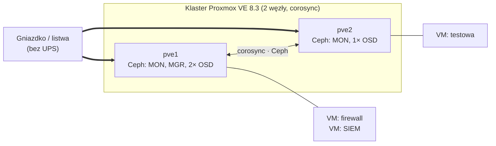

# Day 004 – Oba serwery labu wyłączają się same: diagnoza klastra Proxmox VE

<div class="ad-pills">
<span class="ad-pill hot">nieplanowane wyłączenia</span>
<span class="ad-pill">lab · przypadek rzeczywisty</span>
<span class="ad-pill ok">przyczyna zawężona: zasilanie</span>
<span class="ad-pill warn">brak UPS</span>
</div>

<div class="ad-kpis">
<div class="ad-kpi hot"><small>nieczyste zakończenia pracy</small><b>7 / 7</b><span>każdy poprzedni rozruch pve1 urwany bez zamknięcia systemu</span></div>
<div class="ad-kpi warn"><small>ochrona zasilania</small><b>brak</b><span>bez UPS-a, oba węzły z jednego obwodu</span></div>
<div class="ad-kpi ok"><small>OOM / panic / błędy sprzętu</small><b>0</b><span>w logach z całego roku</span></div>
<div class="ad-kpi ok"><small>zmiany w trakcie diagnozy</small><b>0</b><span>tylko polecenia do odczytu</span></div>
</div>

!!! info "Anonimizacja"
    Adresy IP, nazwa klastra, nazwy pul i odciski kluczy zostały usunięte lub zastąpione.
    Polecenia i wyniki są prawdziwe, zmienione są tylko identyfikatory. Szczegóły:
    [Zasady anonimizacji](../about/anonymization.md).

## 1. Scenariusz

Tym razem biorę na tapetę dwa serwery. Są częścią jednego z moich labów: dwuwęzłowy klaster
Proxmox VE z Ceph. Stoją w sieci wewnętrznej, nie są wystawione do Internetu i **nie mają UPS-a**.
W ostatnim czasie co jakiś czas **same się wyłączały**, a po powrocie
maszyny wirtualne zostawały zatrzymane.

Podejrzenie wzbudziło to, że **wyłączały się oba**. Pojedynczy serwer może mieć swoją
usterkę: zasilacz, przegrzanie, dysk. Dwa naraz to sygnał, że przyczyna jest wspólna.

Zadanie: ustalić, czy maszyny wyłącza Proxmox, system, czy coś poza nimi. Bez zmian
w konfiguracji, wyłącznie na odczycie.

## 2. Środowisko

<figure class="ad-chart">



<figcaption>Oba węzły zasilane z tego samego obwodu, bez UPS-a. Każda przerwa w zasilaniu
gasi je natychmiast i jednocześnie.</figcaption>
</figure>

- **Węzły:** pve1, pve2: Proxmox VE 8.3 (Debian 12), 4 rdzenie, ~8 GB RAM każdy.
- **Klaster:** 2 węzły, 2 głosy, corosync/knet. Storage współdzielony: Ceph (3 OSD, pula RBD).
- **Maszyny:** firewall i SIEM na pve1, maszyna testowa na pve2.
- **Zasilanie:** wspólny obwód, bez UPS-a.
- **Dostęp:** konsola roota w panelu Proxmoxa, SSH między węzłami.

## 3. Problem

- Maszyny wirtualne co jakiś czas okazywały się wyłączone.
- Oba węzły miały świeży czas pracy (`uptime`) po takich zdarzeniach.
- Brak wyraźnego wzorca godzinowego. Raz w nocy, raz w środku dnia.

Trzy hipotezy na start:

| # | Hipoteza | Co by ją potwierdziło |
|---|---|---|
| H1 | Proxmox zatrzymuje maszyny (HA, fencing, zadanie, OOM procesu `kvm`) | zadania `qmstop`/`qmshutdown`, wpisy OOM, fencing w logach |
| H2 | Węzeł się zawiesza lub restartuje z powodu sprzętu albo jądra | `panic`, MCE, przegrzanie, błędy I/O przed końcem logu |
| H3 | Węzły tracą zasilanie | log urwany w pół zdania, brak sekwencji zamykania, oba węzły naraz |

## 4. Diagnostyka

Szedłem od ogółu do szczegółu: historia rozruchów → sposób zakończenia każdego rozruchu →
przyczyny po stronie jądra i Proxmoxa → porównanie obu węzłów.

### Przebieg w skrócie

<ul class="ad-timeline">
<li><b>Historia rozruchów</b><span>8 rozruchów na pve1, nowy rozruch po każdej „awarii”.</span></li>
<li class="hot"><b>Żaden rozruch nie zakończył się zamknięciem systemu</b><span>0 wpisów o wyłączaniu, log urywa się w pół minuty.</span></li>
<li><b>Jądro czyste</b><span>Brak OOM, panic, MCE, przegrzania i błędów dysków.</span></li>
<li><b>Proxmox niczego nie zatrzymał</b><span>W logu zadań tylko starty. Ani jednego <code>qmstop</code>.</span></li>
<li class="hot"><b>Oba węzły padają i wstają razem</b><span>Te same minuty startu, brak śladu utraty sąsiada w corosync.</span></li>
<li class="ok"><b>Maszyny nie wstają, bo nie mają autostartu</b><span>Brak <code>onboot</code> we wszystkich VM.</span></li>
</ul>

### 4.1 Historia rozruchów

```bash
uptime
journalctl --list-boots --no-pager | tail -8
last -x -F | grep -E 'reboot|shutdown|crash' | head -12
```

**Wynik (pve1, fragment):**

```text
 -4 ...  Mon 2026-06-01 18:50:17 CEST  Fri 2026-06-12 16:58:40 CEST
 -3 ...  Sat 2026-06-13 13:37:19 CEST  Sat 2026-06-13 14:10:00 CEST
 -2 ...  Sat 2026-06-13 14:29:34 CEST  Fri 2026-07-17 05:59:14 CEST
 -1 ...  Wed 2026-11-18 21:28:11 CET   Fri 2026-11-20 10:09:29 CET
  0 ...  Fri 2026-11-20 16:34:44 CET   (bieżący)

reboot  system boot  6.8.12-4-pve  Fri Nov 20 16:34:43 2026  still running
reboot  system boot  6.8.12-4-pve  Wed Nov 18 21:28:10 2026  still running
```

Dwie rzeczy rzucają się w oczy. Po pierwsze `last -x` nie zawiera **ani jednego** wpisu `shutdown`.
Po drugie stare rozruchy mają status `still running`. To znaczy, że system nigdy nie zapisał,
że kończy pracę.

### 4.2 Jak kończył się każdy rozruch?

Ostatnie linie dziennika z poprzednich rozruchów:

```bash
for b in -1 -2 -4; do journalctl -b $b -n 6 --no-pager -o short-iso; done
```

```text
2026-11-20T10:08:29+0100 pve1 ceph-mgr[1047]: ... calc_pg_upmaps abort due to max <= 0
2026-11-20T10:09:29+0100 pve1 ceph-mgr[1047]: ... calc_pg_upmaps abort due to max <= 0
```

Zwykły, cykliczny komunikat Ceph co minutę, a potem cisza. Przy poprawnym wyłączeniu
na końcu byłoby zatrzymywanie maszyn i usług.

Sprawdzenie dla wszystkich rozruchów, czy kiedykolwiek pojawiła się sekwencja zamykania:

```bash
for b in $(journalctl --list-boots | awk 'NR>1{print $1}' | tail -8); do
  printf '%s ' $b
  journalctl -b $b -q | grep -cE 'System is powering down|System is rebooting|Stopping.*pve-guests'
done
```

```text
-7 0
-6 0
-5 0
-4 0
-3 0
-2 0
-1 0
0 0
```

**0 we wszystkich rozruchach.** Ani jednego poprawnego wyłączenia w historii pve1.

### 4.3 Czy zabił je system? (H1, H2)

```bash
journalctl --since 2026-01-01 | grep -ciE 'out of memory|oom-kill|killed process'
journalctl -k --since -7d -o short-iso \
  | grep -iE 'oom|mce|hardware error|thermal|watchdog|panic|i/o error|nvme|link is down'
journalctl -b -1 -p err --no-pager -o short-iso | grep -v calc_pg_upmaps
```

**Wynik:**

- `oom-kill`: **0** w całym roku, na obu węzłach.
- Jądro: tylko komunikaty z rozruchu (rejestracja czujników, wykrycie dysków). Brak `panic`,
  MCE, przegrzania i błędów I/O.
- Błędy z poprzedniego rozruchu to wyłącznie start klastra (`quorum_initialize failed` przez kilka
  sekund, zanim wstał corosync), nic przed końcem pracy.

H2 nie znajduje potwierdzenia. Zawieszenie jądra zwykle zostawia ślad (`soft lockup`, `hung task`,
watchdog), a tu log kończy się na zwykłym wpisie.

### 4.4 Czy zatrzymał je Proxmox? (H1)

Każda operacja na maszynie w Proxmoxie to zadanie zapisane w `/var/log/pve/tasks/index`.
Czas startu jest zakodowany szesnastkowo w identyfikatorze zadania (UPID):

```bash
grep -hE 'qmstop|qmshutdown|stopall|startall|qmstart' /var/log/pve/tasks/index | tail -12 \
| while IFS=: read -r _ n _ _ t ty id u rest; do
    echo "$(date -d @$((16#$t)) '+%F %T') $n $ty $id $u ${rest##* }"
  done
```

```text
2026-02-03 14:20:46 pve1 startall  root@pam OK
2026-05-20 20:27:33 pve1 startall  root@pam OK
2026-06-01 18:51:00 pve1 startall  root@pam OK
2026-06-13 13:38:03 pve1 startall  root@pam OK
2026-06-13 14:30:20 pve1 startall  root@pam OK
2026-11-18 21:28:26 pve1 startall  root@pam OK
2026-11-20 16:35:29 pve1 startall  root@pam OK
```

Tylko `startall`, czyli automatyczne zadanie przy każdym starcie węzła. **Ani jednego `qmstop`
czy `qmshutdown`.** HA nie jest skonfigurowane, więc nie ma też fencingu. H1 odrzucona.

### 4.5 Dlaczego maszyny nie wracają po starcie?

```bash
grep -h onboot /etc/pve/nodes/*/qemu-server/*.conf
```

Pusty wynik. **Żadna VM nie ma `onboot: 1`**, więc `startall` przy rozruchu nie ma czego
uruchomić. Stąd objaw „maszyny się wyłączają”. W rzeczywistości padał cały węzeł, a maszyny
po prostu nie wstawały razem z nim.

### 4.6 Porównanie obu węzłów (H3)

Te same polecenia na pve2:

```bash
ssh root@pve2 'journalctl --list-boots --no-pager | tail -8'
```

```text
 -7  Mon 2026-06-01 18:50:00 CEST  Fri 2026-06-12 16:50:38 CEST
 -6  Sat 2026-06-13 13:37:05 CEST  Sat 2026-06-13 14:07:20 CEST
 -5  Sat 2026-06-13 14:29:27 CEST  Fri 2026-07-17 05:29:55 CEST
 -3  Wed 2026-11-18 21:27:24 CET   Fri 2026-11-20 09:28:32 CET
 -2  Fri 2026-11-20 16:34:40 CET   Mon 2026-11-23 17:45:25 CET
```

| Zdarzenie | start pve1 | start pve2 |
|---|---|---|
| 01.06 | 18:50:17 | 18:50:00 |
| 13.06 | 13:37:19 | 13:37:05 |
| 13.06 | 14:29:34 | 14:29:27 |
| 18.11 | 21:28:11 | 21:27:24 |
| 20.11 | 16:34:44 | 16:34:40 |

**Starty co do minuty, w każdym przypadku.** Dwa niezależne komputery nie uruchamiają się
w tej samej minucie przypadkiem. Albo włącza je jedna osoba, albo wraca im jednocześnie prąd
(BIOS z opcją włączenia po powrocie zasilania).

Końce rozruchów wyglądały na pierwszy rzut oka na różne (pve2: 09:28, pve1: 10:09), więc
sprawdziłem, co pve1 widział przed swoim końcem:

```bash
journalctl -b -1 --since '2026-11-20 09:15' -o short-iso \
  | grep -vE 'calc_pg_upmaps|pgmap v' | tail -20
```

```text
09:17:01 CRON[565736]: (root) CMD (cd / && run-parts --report /etc/cron.hourly)
09:28:32 pmxcfs[923]: [dcdb] notice: data verification successful
```

O 09:28:32 **oba** węzły zapisały ten sam cykliczny wpis `pmxcfs`, a potem do końca pracy
pve1 logował już tylko ceph-mgr. Gdyby pve2 padł o 09:28, pve1 zapisałby utratę sąsiada:
zmianę członkostwa w corosync i utratę quorum. Takich wpisów nie ma. pve2 po prostu nic więcej
nie logował, bo nie ma na nim aktywnego ceph-mgr. **Oba węzły zgasły w tej samej chwili.**

Wyróżniają się tylko dwa dzisiejsze rozruchy pve2 (17:45 i 17:47). To były ręczne,
poprawne restarty („Bulk shutdown”), z sekwencją zamykania w logu. Dla porównania: rozruch
zakończony 20.11 ma tam 0 takich wpisów.

## 5. Przyczyna

!!! danger "Root cause (najbardziej prawdopodobna)"
    **Oba węzły tracą zasilanie jednocześnie.** Każdy rozruch kończy się bez sekwencji
    zamykania, w logach nie ma OOM, panic ani błędów sprzętu, Proxmox nie wydał żadnego
    polecenia zatrzymania, a węzły startują w tej samej minucie.

    Serwery nie mają UPS-a, więc każda przerwa w zasilaniu wyłącza je natychmiast i bez
    zamknięcia systemu: chwilowy zanik lub spadek napięcia w sieci, zadziałanie bezpiecznika
    albo różnicówki, wyłączenie lub uszkodzenie wspólnej listwy.

    **Dlaczego VM „się wyłączają”:** żadna maszyna nie ma `onboot`, więc po powrocie zasilania
    węzły wstają, a maszyny zostają zatrzymane.

Czego **nie** potwierdzam z samych serwerów: co dokładnie przerwało zasilanie. Do sprawdzenia:
czy w tych dniach były zaniki prądu w budynku, czy coś innego w tym samym obwodzie też się
wyłączało, oraz stan listwy i wtyczek.

## 6. Rozwiązanie

### Natychmiastowe

Brak zmian w trakcie diagnozy. Wszystkie polecenia były tylko do odczytu.

### Zaplanowane

| Priorytet | Zmiana | Efekt |
|---|---|---|
| 1 | Sprawdzić obwód: listwę, wtyczki, bezpiecznik, czy zaniki pokrywają się z innymi urządzeniami w domu | potwierdzenie przyczyny |
| 1 | **UPS** dla obu węzłów (line-interactive, z portem USB) | krótkie zaniki i spadki napięcia przestają wyłączać serwery |
| 1 | **NUT**: UPS przez USB do jednego węzła (`nut-server`), drugi węzeł jako `nut-client` | przy dłuższym zaniku oba węzły zamykają się poprawnie, Ceph i VM bez ryzyka uszkodzenia |
| 1 | Autostart maszyn: `qm set <vmid> --onboot 1 --startup order=N` (firewall pierwszy) | po powrocie zasilania usługi wstają same |
| 2 | Sprawdzić w BIOS-ie *Restore on AC Power Loss* na obu węzłach | świadoma decyzja, czy węzły mają startować same |
| 2 | Alert w monitoringu (Zabbix) na restart węzła, później też na stan UPS z NUT | informacja o zdarzeniu od razu, a nie gdy ktoś zauważy wyłączoną VM |
| 3 | Trzeci głos w klastrze (QDevice) | przy awarii jednego węzła drugi zachowuje quorum |

Przykład konfiguracji NUT po zakupie UPS-a (węzeł z kablem USB):

```bash
apt install nut
nut-scanner -U                       # wykrycie UPS-a na USB
# /etc/nut/nut.conf:     MODE=netserver
# /etc/nut/ups.conf:     [ups] driver=usbhid-ups port=auto
# /etc/nut/upsd.conf:    LISTEN 0.0.0.0 3493   (żeby drugi węzeł mógł się podłączyć)
# /etc/nut/upsd.users:   użytkownik dla upsmon (primary) i dla drugiego węzła (secondary)
# /etc/nut/upsmon.conf:  MONITOR ups@localhost 1 <użytkownik> <hasło> primary
systemctl restart nut-server nut-monitor
upsc ups@localhost                  # stan baterii, obciążenie, status OL/OB/LB
```

Na drugim węźle `MODE=netclient` i `MONITOR ups@<węzeł-z-UPS> 1 <użytkownik> <hasło> secondary`.

## 7. Weryfikacja (po wdrożeniu)

- [ ] UPS zainstalowany, `upsc` na obu węzłach pokazuje status `OL` (zasilanie z sieci)
- [ ] test: odłączenie UPS-a od gniazdka → serwery działają dalej, status `OB`, zdarzenie w logu i w monitoringu
- [ ] test kontrolowanego zamknięcia (`upsmon -c fsd`) → w logu `System is powering down`
- [ ] po włączeniu węzłów maszyny startują same, w ustalonej kolejności
- [ ] w kolejnych tygodniach: każdy koniec rozruchu ma sekwencję zamykania

## 8. Wnioski

- **„Maszyny się wyłączają” to opis objawu, nie przyczyny.** Pierwsze pytanie brzmi:
  wyłączyła się maszyna czy cały host? Tutaj `journalctl --list-boots` odpowiedział od razu.
- **Brak śladu to też ślad.** Log urwany na zwykłym, cyklicznym wpisie, bez zamykania
  i bez błędów, to sygnatura nagłej utraty zasilania.
- **Dwa serwery naraz = wspólna przyczyna.** Porównanie czasów startu obu węzłów przesądziło
  sprawę szybciej niż szukanie usterki w każdym z osobna.
- **Pozorne różnice w czasie trzeba sprawdzić.** pve2 „kończył” 40 minut wcześniej tylko
  dlatego, że był cichszy w logach. Brak wpisów corosync o utracie sąsiada to rozstrzygnął.
- **Klaster bez UPS-a to dwa serwery z jednym wspólnym wyłącznikiem.** Redundancja węzłów
  nic nie daje, gdy oba wiszą na tej samej listwie. UPS z NUT to pierwszy zakup do takiego labu.
- **Autostart maszyn to konfiguracja, o której łatwo zapomnieć.** Bez `onboot` każda przerwa
  w zasilaniu zamienia się w ręczną interwencję.

## 9. Dowody (zanonimizowane)

- `journalctl --list-boots` z obu węzłów: zbieżne godziny startów.
- Licznik sekwencji zamykania = 0 dla wszystkich poprzednich rozruchów pve1.
- Log zadań Proxmoxa: wyłącznie `startall` i `qmstart`, brak `qmstop`/`qmshutdown`.
- Brak wpisów OOM w całym roku i brak błędów jądra przed końcem rozruchów.
